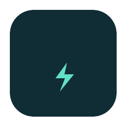

# Duracell Energy Cloud

Unofficial, read-only Home Assistant integration for Duracell Energy cloud monitoring.

Monitor your battery, solar generation and home power from Home Assistant. One shared cloud request refreshes all sensors every two minutes by default.

**v0.7.0:** solar/grid energy estimates, a native dashboard generator, connection health and additional battery monitoring, alongside automatic login and battery energy totals. Live login, discovery and telemetry were verified against the provider’s public demo account; verification on the owner’s Home Assistant installation is still pending. The original v0.3.0 was reported working with a Dura-i G3 inverter and Dura16 batteries; other models are unverified.

## Features

- Battery percentage, voltage and signed power.
- Separate battery charging and discharging power, plus charging/discharging/idle status.
- Built-in battery charged/discharged, grid imported/exported and solar DC energy estimates in kWh, restored across restarts.
- Read-only battery temperature, health, capacity and BMS limits where supplied by the API.
- Cloud connection health, last successful update and consecutive failure count.
- A ready-made dashboard generator using your actual entities and native cards.
- Solar DC power, home load, signed grid power, backup EPS and generator power.
- Username/password setup, automatic signing and discovery across account sites.
- Automatic selection of a single inverter or a choice when several are available.
- Shared polling, bounded login renewal and Home Assistant reauthentication.
- Configuration editing and diagnostics containing no raw cloud responses or credentials.
- Existing v0.3.0 device and sensor identifiers retained.

## Install with HACS

Requires Home Assistant 2024.12 or newer and HACS. This repository is not yet in the default HACS catalog.

1. In HACS, open **Custom repositories** from the menu.
2. Add `https://github.com/hope22/duracell-energy-cloud` with type **Integration**.
3. Find **Duracell Energy Cloud**, download it and restart Home Assistant.
4. Open **Settings → Devices & services → Add integration** and search for **Duracell Energy Cloud**.
5. Enter the connection details described in [Configuration](docs/configuration.md).

For an existing manual installation, follow [the migration guide](docs/installation.md) first; do not delete the configured integration.

## Setup limitations

Enter your monitoring username and password. Setup discovers supported hybrid inverters automatically; no signatures, tokens or serial numbers need to be entered. Existing v0.4.0 manual configurations remain compatible and can switch through **Reconfigure**.

No battery controls or charging schedule changes are sent. The API is unofficial and may change without notice. Data refreshes depend on the provider's own reporting cadence.

## Sensors

| Reading | Unit / meaning |
| --- | --- |
| Battery state of charge | % |
| Battery power (signed) | W; positive discharge, negative charge |
| Battery charging / discharging power | W; separate non-negative readings |
| Battery activity | charging, discharging, idle |
| Battery energy charged / discharged | kWh; estimated cumulative totals |
| Battery voltage | V |
| PV DC power (reported) | W; provider's DC reading |
| Home load / backup EPS / generator power | W |
| Grid power (signed) | W; positive import, negative export (portal convention) |
| Grid import / export power | W; separate non-negative readings |
| Solar DC / grid imported / grid exported energy | kWh; estimated cumulative totals |
| Inverter mode code | Raw provider code |

Missing or invalid numerical readings remain unknown rather than becoming zero. A failed cloud update makes the coordinator's entities unavailable.

## Energy Dashboard

Select the built-in **Battery energy charged** and **Battery energy discharged** sensors in the Energy Dashboard. No helpers are required. These kWh totals are estimated from cloud power samples, start from installation, and persist across normal restarts. Missing readings, outages and downtime are not backfilled. See [Energy Dashboard setup](docs/energy-dashboard.md) for configuration and limitations. Grid import/export direction follows the provider's portal convention. Solar DC energy is before inverter losses and is labelled accordingly.

## Updates and support

New tagged GitHub releases can be installed from HACS, followed by a Home Assistant restart. Pushing a commit alone is not the documented stable release process.

- [Ready-made dashboard](docs/dashboard.md)
- [Connection health and battery details](docs/monitoring.md)
- [Installation and upgrades](docs/installation.md)
- [Configuration](docs/configuration.md)
- [Troubleshooting](docs/troubleshooting.md)
- [Changelog](CHANGELOG.md)
- [Contributing](CONTRIBUTING.md)
- [Release checklist](docs/releasing.md)

An independent community project, not affiliated with or endorsed by Duracell, Duracell Energy or the monitoring provider. Product names belong to their respective owners. MIT licensed.
